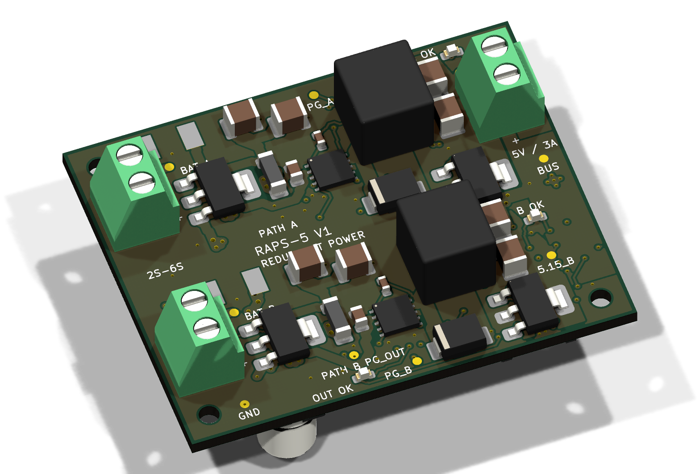
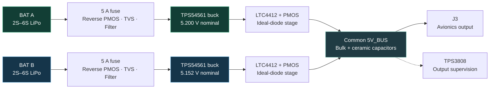
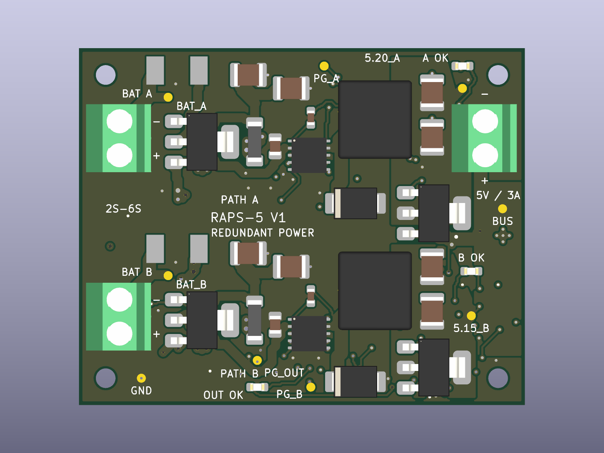
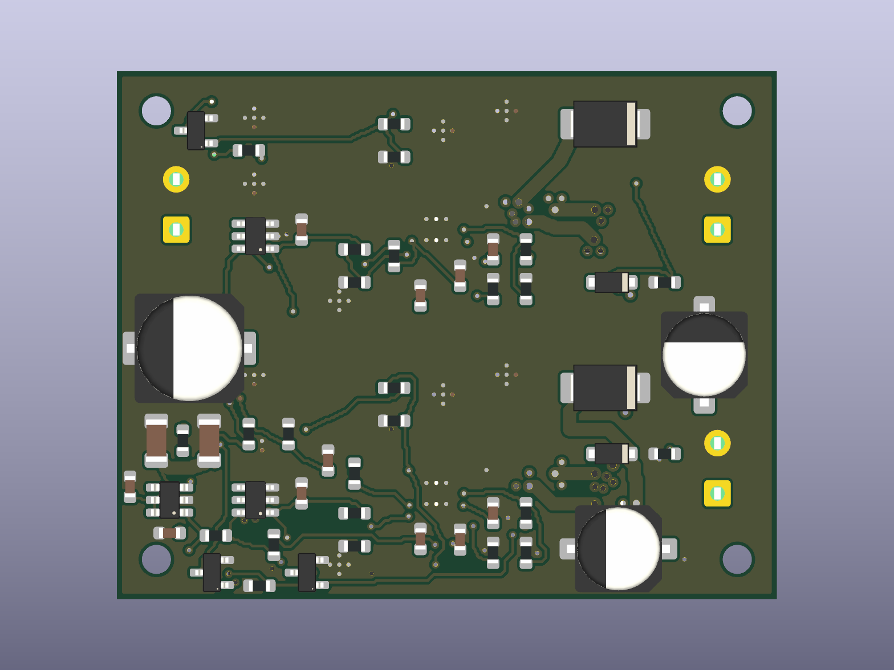

<p align="center">
  
</p>

<p align="center">
  <strong>Redundant Avionics Power Supervisor</strong><br>
  A compact, dual-input power module for experimental UAV and robotics systems.
</p>

<p align="center">
  <a href="hardware/RAPS-5_V1.kicad_pro">KiCad project</a> ·
  <a href="docs/drawings/RAPS-5_schematic.pdf">Schematic PDF</a> ·
  <a href="manufacturing/BOM.csv">Bill of materials</a> ·
  <a href="docs/DESIGN.md">Design notes</a> ·
  <a href="validation/BENCH_VALIDATION.md">Bench validation</a>
</p>

<p align="center">
  
</p>

> **Prototype status** — Schematic, PCB and fabrication exports are included. ERC, DRC and schematic-to-PCB parity checks pass under the saved project settings. **3 A continuous output is a design target; physical bench validation is pending.**

## Two paths. One purpose.

RAPS-5 brings two independently protected LiPo inputs onto a common avionics power bus. Each path has its own fuse, reverse-polarity protection, transient suppression, input filtering and buck converter. Independent ideal-diode controllers combine the regulated outputs while blocking backfeed into an inactive path.

The result is a **50 × 40 mm, four-layer PCB** with clearly labeled connectors, three voltage-status LEDs and accessible test points.

| At a glance | Design |
| :--- | :--- |
| Battery inputs | Two 2S–6S LiPo inputs; up to 25.2 V normal input |
| Local regulated outputs | Path A: 5.200 V · Path B: 5.152 V nominal |
| Continuous output | 3 A design target from either path |
| Buck converters | Two TPS54561DPRR devices, approximately 400 kHz |
| Output combining | Two LTC4412 controllers with external P-channel MOSFETs |
| PCB | 50 × 40 mm · 4 layers · 1.6 mm FR-4 · ENIG |
| Copper | 2 oz outer layers / 1 oz inner layers |
| Monitoring | PATH A OK · PATH B OK · OUTPUT OK |
| Design tool | KiCad 10; verified with 10.0.5 |

## Power architecture



**The positive power paths remain separate until OR-ing. Ground is shared; the inputs are not galvanically isolated.** Each path is intended to support the full load on its own. The small voltage offset nominally favors A, but does not guarantee source priority or equal current sharing.

The 5.200 V and 5.152 V figures are converter setpoints **before** the OR-ing MOSFETs. Loaded BUS voltage is lower because of MOSFET and copper losses; approximately 5.1 V at 3 A is an estimate to verify on the bench.

## Board tour

<table>
  <tr>
    <th>Top — power stages and connectors</th>
    <th>Bottom — controls and bulk capacitance</th>
  </tr>
  <tr>
    <td></td>
    <td></td>
  </tr>
</table>

*Images are CAD renders. Some components do not have 3D models; these are not photographs of an assembled or tested board.*

- **Separated channels:** Path A and Path B occupy distinct regions, with local switching power stages.
- **Power copper:** wide outer-layer routes, local pours and multiple plated barrels at main layer transitions.
- **Ground plane:** In1.Cu provides the common ground plane.
- **Mechanical fit:** four M2 clearance holes and labeled input/output polarity.
- **Bring-up access:** battery, regulated rail, BUS, GND and power-good test points.

### Connections

| Connector | Function | Pin 1 | Pin 2 |
| :--- | :--- | :--- | :--- |
| J1 | Battery A input | BAT_A positive | GND |
| J2 | Battery B input | BAT_B positive | GND |
| J3 | Avionics output | 5V_BUS positive | GND |

All three use 3.81 mm, two-pin Phoenix terminal-block footprints. PATH A OK and PATH B OK indicate converter power-good status; OUTPUT OK indicates the supervised BUS voltage. LEDs do not indicate which source is carrying current. Power-good test points have local pullups; check voltage compatibility with external logic.

## Open the design

1. Download or clone this repository and keep its directory structure intact.
2. Open [`hardware/RAPS-5_V1.kicad_pro`](hardware/RAPS-5_V1.kicad_pro) in **KiCad 10**.
3. Open the schematic editor for the four-sheet circuit, or the PCB editor for the routed board.
4. Install KiCad's standard 3D-model libraries for the available component models.

Project-local symbols and footprints are included under `hardware/libraries/`. The library tables use `${KIPRJMOD}`, so no machine-specific library paths are required. No generator or autorouter script is needed to open or edit the delivered design.

## Repository map

```text
hardware/                 Native KiCad project, four schematic sheets and PCB
  libraries/              Project-local symbols and footprints
docs/
  DESIGN.md               Circuit behavior, component choices and limits
  drawings/               Schematic, assembly and copper PDFs
  images/                 README artwork and native 3D renders
manufacturing/
  BOM.csv                 Component values, footprints and key part numbers
  placement.csv           Assembly placement export
  gerbers/                Four-layer Gerbers, drills, drill maps and job file
validation/
  erc.json                Electrical-rule check results
  drc.json                Design-rule, connectivity and parity results
  BENCH_VALIDATION.md      Physical test plan and screening criteria
  bench_results.csv       Unfilled measurement worksheet
licenses/                 Bundled KiCad library license texts
```

### Browse the deliverables

| Need | File |
| :--- | :--- |
| Review the circuit | [Four-sheet schematic](docs/drawings/RAPS-5_schematic.pdf) |
| Identify and place components | [Assembly drawing](docs/drawings/RAPS-5_assembly.pdf) · [BOM](manufacturing/BOM.csv) · [Placement](manufacturing/placement.csv) |
| Inspect the copper layers | [Copper drawing](docs/drawings/RAPS-5_copper.pdf) |
| Prepare a prototype build | [Manufacturing notes](manufacturing/README.md) · [Gerber and drill files](manufacturing/gerbers/) |
| Understand the electronics | [Detailed design notes](docs/DESIGN.md) |
| Plan the first power-up | [Bench validation procedure](validation/BENCH_VALIDATION.md) |

## Verification and next steps

| Check | Current result |
| :--- | :--- |
| ERC | 0 errors · 0 warnings |
| DRC | 0 errors · 0 warnings |
| Unconnected PCB items | 0 |
| Schematic-to-PCB parity issues | 0 |
| Thermal, ripple and load-step measurements | Pending |
| Source-disconnection and reverse-current measurements | Pending |

The JSON reports record the check date, KiCad version and ignored check categories. CAD checks establish connectivity and geometric consistency; physical tests must establish continuous-current capability, converter stability and transient behavior. See [validation notes](validation/README.md) for repeatable CLI commands.

Before an operational build, validate each path at the full load, input-voltage extremes and intended ambient temperature. Nominal input undervoltage thresholds are approximately **6.5 V startup / 6.2 V shutdown**; regulation at a deeply discharged 2S pack's 6.0 V is not promised.

This is experimental UAV/robotics hardware, without aircraft certification. The shared BUS and ground remain common failure points. There is **no independent output overvoltage disconnect**; a shorted buck high-side switch can expose the output to battery voltage.

## Project and library licensing

A license for the original board design and documentation has not yet been selected. Bundled KiCad library data retains its upstream terms and attribution; see [LICENSES.md](LICENSES.md). No open-hardware certification or license grant is implied.
